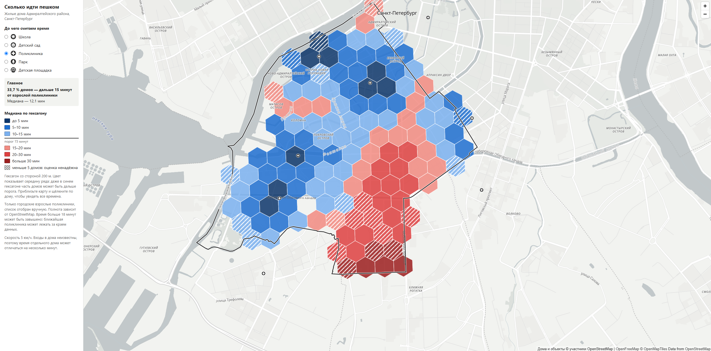

# Петербург: солнце и доступность



**От трети жилых домов Адмиралтейского района (33,7 %) до ближайшей взрослой городской поликлиники идти пешком дольше 15 минут, а школа, детский сад, парк и детская площадка есть рядом почти у всех.**

## Что за проект

Учебный проект по городской среде на данных OpenStreetMap. Для каждого жилого дома Адмиралтейского района Санкт-Петербурга посчитано время пешком до ближайшей школы, детского сада, поликлиники, парка и детской площадки. Результат показан на интерактивной карте.

Вторая часть проекта, 3D-сцена с солнцем и расчёт часов солнца для дворов и фасадов, ещё не сделана.

**Карта:** https://lolnecrt.github.io/spb-sun-access/

## Данные

Источник: [OpenStreetMap](https://www.openstreetmap.org/copyright), © участники OpenStreetMap, лицензия ODbL. Снимок сделан 30 октября 2026 года, пешеходный граф — 31 октября. Территория: район и запас 1500 м вокруг него, потому что ближайший объект может стоять в соседнем районе.

Что скачано: граница района, контуры зданий, школы, детские сады, клиники, парки, детские площадки и пешеходный граф. Все файлы лежат в [data/](data/). Подложка карты: OpenFreeMap.

## Метод

1. **Дома.** 2530 домов района: 903 отмечены как жилые в OSM, ещё 1627 определены правилом (адрес, площадь, этажность, нет названия).
2. **Объекты.** Отобраны те, что подходят для вопроса: общеобразовательные школы, 10 записей городских взрослых поликлиник (список вручную), парки от 1000 м², площадки без закрытых.
3. **Сеть.** Пешеходный граф OSM, из него убраны дорожки, закрытые для пешехода по тегам `access` и `foot`.
4. **Привязка.** Дом соединяется с ближайшим узлом графа отрезком по прямой. Контур объекта представлен точками по границе с шагом 25 м: до парка идут к его краю, а не к центру.
5. **Поиск.** Алгоритм Дейкстры запускается один раз для каждого типа сразу от всех его объектов и даёт расстояние до ближайшего.
6. **Время.** Длина пути делится на скорость 5 км/ч. «Далеко» значит дольше 15 минут. Эти и другие допущения лежат в [scripts/config.py](scripts/config.py).
7. **Сводка.** Для каждого типа считаются медиана и доля домов дольше 15 минут, по району и по гексагонам со стороной 200 м.

## Ограничения

- **Полнота OSM.** Данные с официальными реестрами не сверялись. Поликлиника с другим названием или тегами в список не попала, поэтому 33,7 % может быть завышением.
- **Детские поликлиники.** Все три записи лежат вне района, поэтому выводов по ним делать нельзя. На шкалу карты они не выведены.
- **Не все дома жилые.** При ручной проверке 20 случайных домов, определённых правилом, 6 оказались нежилыми. Это грубая оценка: среди всех домов нежилых около 19 % (интервал 9–33 %). Сводка только по домам, отмеченным в OSM, близка к общей (по поликлиникам 30,6 % вместо 33,7 %), но это показывает устойчивость, а не точность.
- **Время одного дома неточно.** Оно может отличаться на несколько минут: входы в дома неизвестны, ворота и многие закрытые дворы не учтены. Светофоры тоже не учтены, а дети и пожилые ходят медленнее 5 км/ч.
- **Дома, а не люди.** Большой дом и маленький особняк весят одинаково: числа жителей в данных нет.
- **Ближайшая не значит своя.** В школу и поликлинику прикрепляют по адресу, а расчёт показывает только географию.

## Как запустить локально

Нужен Python 3 и интернет: библиотека карты и подложка загружаются извне. Двойной щелчок по `index.html` не подойдёт, браузер не даст странице прочитать файлы с данными. Команды для Windows PowerShell, в корне проекта:

```powershell
python -m venv .venv
.venv\Scripts\python.exe -m http.server 8000
```

Затем откройте http://localhost:8000/. Остановить сервер: Ctrl+C.

Чтобы пересчитать данные, установите библиотеки и запустите скрипты по порядку. Файлы, которые уже лежат в `data/`, скрипт `01_download.py` заново не скачивает.

```powershell
.venv\Scripts\python.exe -m pip install -r requirements.txt
.venv\Scripts\python.exe scripts\01_download.py
.venv\Scripts\python.exe scripts\02_classify_schools.py
.venv\Scripts\python.exe scripts\03_access.py
.venv\Scripts\python.exe scripts\04_map_data.py
```

## Подробнее

- [Шаг 1. Данные OpenStreetMap](docs/step1_download.md)
- [Шаг 2. Пешеходная доступность](docs/step2_access.md)

## Лицензия

Код — MIT, данные — ODbL, © участники OpenStreetMap. Подробности в файле [LICENSE](LICENSE).
